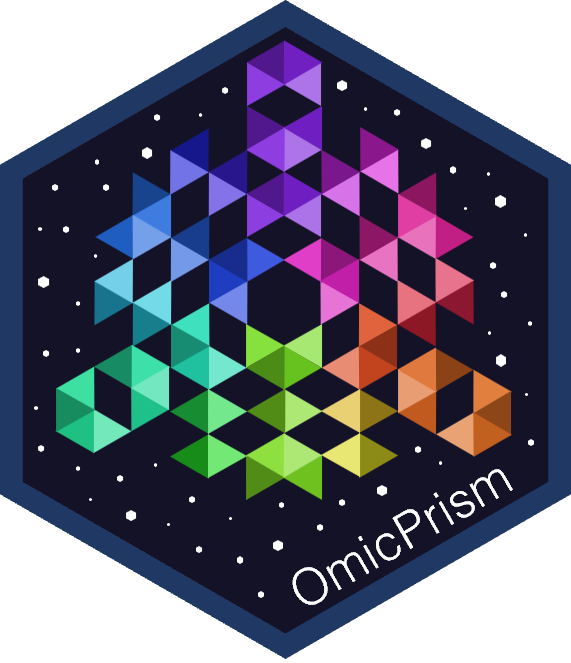

# OmicPrism v1.0



R Shiny application for omics visualization, time-series clustering and pathway enrichment.

The application includes Overlap, PCA, Volcano, Heatmap, Mfuzz, ORA, ssGSEA, Single GSEA and Comparative GSEA modules.

<br clear="right" />

## Use it online

**https://omicprism.org**

The hosted version runs on Posit Connect Cloud (free plan), so it has limited memory and monthly
compute time. For large datasets, heavy use or sensitive data, run OmicPrism on your own computer
(below): nothing is uploaded anywhere.

## Run locally

OmicPrism was developed and tested with R 4.6.1 and Bioconductor 3.23. From an interactive R
session, run it straight from GitHub:

```r
install.packages("shiny")
shiny::runGitHub("pefjordao/OmicPrism")
```

or download/clone this repository and run, from R:

```r
shiny::runApp("path/to/this/folder")
```

The first run in an interactive session installs any missing CRAN and Bioconductor packages
(listed at the top of `app.R`). This can take a while, because Bioconductor packages have many dependencies.

## Application files

Keep these files and directories together when moving or deploying the application:

- `app.R`: application startup, navigation and module registration.
- `modules/`: analysis modules and shared helpers.
- `ui/home.R`: home page and example download handlers.
- `www/`: OmicPrism icon, stylesheet and navigation script.
- `case/`: the 16 example files linked from the home page.
- `manifest.json`: package list that Posit Connect Cloud reads to build the hosted version.
- `renv.lock`: package versions the app was developed and tested with.

Example downloads are served by Shiny directly from `case/`. The home page is generated by Shiny
and requires no separate HTML file.

## Package versions

`renv.lock` records the R packages (CRAN and Bioconductor 3.23) the app was developed and tested
with, using R 4.6.1. The hosted version installs from `manifest.json` instead. It is the same list
with two differences, so that Posit can install prebuilt binaries instead of compiling packages:

- packages with compiled code that were a patch or minor release behind use their current release
  (for example GSVA 2.6.11 instead of 2.6.3, and eulerr 8.3.1 instead of 8.1.0);
- five small utility packages (`base64enc`, `MatrixModels`, `numDeriv`, `urca`, `uuid`) were
  development builds on the development machine and use the latest CRAN release.

Results from the hosted version can therefore differ slightly from a local run. To reproduce the
tested versions exactly, run OmicPrism locally with the versions listed in `renv.lock`.

## License

OmicPrism is released under the GNU General Public License v3.0. See [LICENSE](LICENSE).
